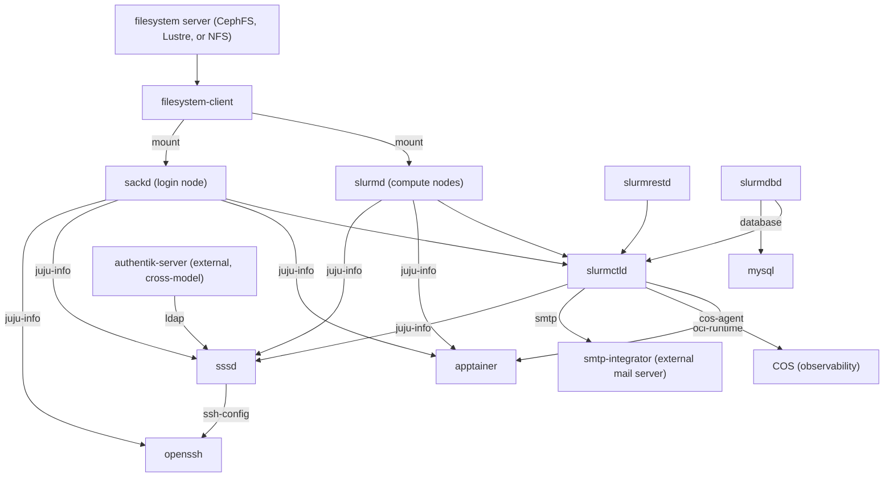

# Charm and product promotion criteria for Charmed HPC

## Abstract

This specification defines what testing and release hygiene must be satisfied to
promote Charmed HPC artifacts along the Charmhub risk ladder
`edge -> beta -> candidate -> stable`. It covers two levels:

- **Single charm**: the criteria that govern promotion of an individual Ubuntu Juju
  charm, using the `canonical/slurm-charms` monorepo (`slurmctld`, `slurmd`,
  `slurmdbd`, `sackd`, `slurmrestd`) as the worked example.
- **Charmed HPC product (multi-charm)**: the cross-charm criteria that only make
  sense when the full product is deployed together. The product criteria
  build on the single-charm criteria: a product promotion assumes each constituent
  charm has independently satisfied the single-charm gates for the same target
  channel, and adds the cross-charm gates on top.

## Rationale

Charmed HPC is composed of multiple cooperating charms that are released and promoted
independently, yet consumed together as a product. Without a well-defined promotion
process at both levels, it is difficult to know what evidence justifies moving a
specific artifact from one risk channel to the next, or to reason about the maturity
of the product as a whole.

A shared, reusable set of promotion criteria lets each charm maintainer promote
their charm against consistent gates, and lets the product manager reason about the
combined stack using the **weakest-link rule** (the product is only as mature as its
least-mature required constituent). This keeps promotions deliberate and auditable
rather than ad-hoc judgement.

The model is grounded in:

- The Charmhub [track + risk channel](https://juju.is/docs/juju/channel) release model.
- The [Charmed HPC contributing guide](https://github.com/canonical/hpc-team/blob/main/CONTRIBUTING.md).
- Common industry progressive-delivery practice (alpha/beta/RC/GA with bake time,
  long-duration reliability testing, and staged sign-off).

## Specification Part A: Single-charm promotion criteria

### A.1 Purpose and scope

This part defines what testing and release hygiene must be satisfied to promote
a single Ubuntu Juju charm along the Charmhub risk ladder:

```
edge  ->  beta  ->  candidate  ->  stable
```

It is written to be reusable for any single charm, and uses the `canonical/slurm-charms`
monorepo (`slurmctld`, `slurmd`, `slurmdbd`, `sackd`, `slurmrestd`) as the worked
example. Part B layers additional cross-charm gates on top of this one for the full
Charmed HPC product.

#### A.1.1 What a "promotion" is

A promotion moves a specific charm revision from one risk channel to the next
*within the same track* (for example, `latest/edge` -> `latest/beta`, or
`24.11/beta` -> `24.11/candidate`). Promotion never rebuilds the artifact: the same
revision that passed the lower channel is what gets released to the higher one. This
is the standard "build once, promote the artifact" principle.

### A.2 Channel and versioning model

#### A.2.1 Risk channels (the promotion ladder)

| Channel     | Audience                         | Intent                                                      | Stability contract |
|-------------|----------------------------------|------------------------------------------------------------|--------------------|
| `edge`      | Charm developers, CI             | Every merge to the tracked branch; may break at any time    | None |
| `beta`      | Early adopters, integration labs | Feature-complete for this version increment; functional testing against the target base achieved | Deploys and passes full functional and acceptance tests |
| `candidate` | Release validators, operators evaluating an upgrade | Release candidate after extended reliability testing; no known critical or high defects    | Production-shaped; upgrade and rollback verified |
| `stable`    | Production users                 | Supported, documented, scale-tested, backwards-compatible release         | Full support contract; guaranteed upgrade path from the previous `stable` |

#### A.2.2 Tracks

A Charmhub **track** groups a compatible line of the charm. For charms with an
upstream project that follows its own major/minor versioning (such as the Slurm
charms), tracks follow that upstream line, e.g. a `YY.MM` track (`track/25.11` in
git) plus `latest` for the current development line. Not every charm has an
upstream to track this way; for those, `latest` may be the only track, or tracks
may instead mark some other compatibility boundary (for example, a breaking
change to a relation interface).

Guidance:

- One track per independently-promoted compatibility line (e.g. per supported
  Slurm major line, where applicable).
- A single track/channel can support multiple Ubuntu bases and architectures at
  once (per the `platforms` entries in `charmcraft.yaml`); the base/architecture is
  not itself part of the track. Adding a new base or architecture is a new platform
  matrix entry that must re-clear the gates below.
- `latest` maps to the `main` git branch; `YY.MM` maps to `track/YY.MM`.

### A.3 Testing dimensions

Each dimension is a class of evidence that a promotion gate can require. Test
plans for these dimensions use the test plan types defined in OO001:
functional, component, performance, reliability, and security.
Acceptance tests should be written in BDD style for clarity and maintainability.

| Dimension            | OO001 type  | Question it answers                             | Tooling |
|----------------------|-------------|-------------------------------------------------|---------|
| **Unit**             | N/A | Does the charm logic behave correctly in isolation | `pytest` + `ops.testing` (Scenario/Context) via `just unit` |
| **Integration**      | functional  | Does the charm deploy, relate, and run against a live Juju/LXD | `jubilant` via `just integration` |
| **Acceptance**       | functional  | Does the charm satisfy user-facing behaviors end to end | `jubilant` today; full scenario coverage *(target)* |
| **Upgrade / refresh**| functional  | Can users move between revisions without data/config loss | `juju refresh` across revisions in a `jubilant` test *(target for full matrix)* |
| **Multi-charm**      | component   | Does it cooperate with the charms it integrates with | See Part B |
| **Performance**      | performance | Does it meet scale and performance baselines    | Charm-level timings from the integration suite *(target)*; `charmed-hpc-benchmarks` covers product-level performance and scale (Part B) |
| **Reliability**      | reliability | Does it stay healthy under failure and sustained load (HA) | `--run-high-availability`; scheduled sustained-load runs |
| **Security**         | security    | Is the artifact free of unresolved critical/high vulnerabilities | CVE/dependency scans |

#### A.3.1 Definitions

- **Unit tests** exercise charm handlers, config, actions, and libraries with a mocked
  Juju model. Every charm action must have test coverage: unit coverage where the
  action's logic can be exercised with a mocked model, integration coverage where the
  action requires a live deployment to be meaningfully tested.
- **Integration tests** deploy the packed charm to a real controller, form its
  relations, and assert active/idle status plus basic workload function. The minimal
  deploy-and-verify subset of these tests is used as a fast *functional* gate before
  deeper testing.
- **Acceptance tests** express behaviors as `Given/When/Then` scenarios that a
  non-developer stakeholder can read (e.g. "Given a running cluster, When a user submits
  a batch job, Then it completes and returns output").
- **Upgrade / refresh tests** deploy revision N-1 (or previous stable), `juju refresh`
  to the candidate revision, and assert data/config preservation and healthy status.
  Rollback tests refresh back down and assert recovery.
- **Multi-charm (component) tests** verify the charm against the other charms it
  integrates with.
- **Performance tests** cover horizontal/vertical scale and a performance baseline
  with an agreed regression budget.
- **Reliability tests** cover HA failover and resilience in non-ideal scenarios, and
  sustained, representative load over an extended period (multi-hour to multi-day) to
  detect memory leaks, resource exhaustion, restarts, and status flaps.
- **Security tests** cover CVE/dependency scanning of the artifact and its
  dependencies, and checks that non-admin users cannot perform privileged
  operations.

### A.4 Per-channel promotion gates

Legend: **[CI]** enforced automatically in CI; **[MAN]** manual sign-off; **[CI/MAN]**
CI-produced evidence that a human reviews. *(target)* = not yet implemented in-repo.

#### A.4.1 Promote to `edge`

Trigger: merge to the tracked branch (`main` or `track/*`). Fully automated.

- [CI] Static checks pass: `just check` (format, lint, typecheck).
- [CI] Unit tests pass: `just unit`.
- [CI] Unit coverage >= 85% line coverage (proposed default; currently reported
  via the coverage report / TICS) *(target: fail the build below threshold)*.
- [CI] Charm packs successfully for every supported base (`just repo stage <charm>`
  + `charmcraft pack`).
- [CI] Minimal functional integration: deploy + reach `active/idle` on at least one
  base (a minimal subset of `just integration`, e.g. selected by a pytest marker;
  see A.3.1).
- [CI] `commitlint` checks pass.
- [CI] Auto-published to `<track>/edge` (`canonical/charming-actions/upload-charm`).

#### A.4.2 Promote to `beta`

Intent: feature-complete for this increment and known-good on the target base.

Requires everything in `edge`, plus:

- [CI] Full integration suite green on every supported base: `just integration`.
- [CI] Every charm action is exercised by an integration or unit test.
- [CI] Every `provides`/`requires` relation is exercised by an integration test
  (relation data flows and both sides settle). Where the partner is external
  to the charm under test (COS, SMTP, Apptainer, an identity provider), a local
  stand-in for the external service is sufficient. Existing practice: the
  `slurm-charms` mail tests use an `aiosmtpd` capture server for the external
  mail server, and `sssd-operator` uses OpenLDAP with an Authentik-style schema
  for Authentik. Validation against the real partner is a product gate (Part B).
- [CI] Reliability / HA (single-charm) suite passes:
  `just integration -- --run-high-availability`. For HA-capable charms, leader loss
  and failover recover the charm to healthy on its own (e.g. `slurmctld` failover);
  charms without an HA story must instead document why the suite is not applicable.
  Job survival across failover with the rest of the stack live is a product gate,
  see B.3.2.
- [CI] Security check (single-charm): CVE/dependency scan of the
  artifact and its Python/OS dependencies with no unresolved critical/high
  findings, and checks pass that non-admin users cannot perform privileged
  operations *(target: some charms have these checks today; extend to all)*.
- [CI] Acceptance scenarios pass, covering the charm's primary user
  journeys *(target)*.
- [CI] Basic upgrade check *(target)*: `juju refresh` from the previous released
  revision (or previous `stable`, if none) to the candidate revision preserves
  data/config and returns to healthy status. The full upgrade/rollback matrix is a
  `candidate` gate (A.4.3).
- [CI/MAN] Coverage has not regressed versus the current `beta` revision (or the
  previous revision, if none is on `beta` yet).
- [MAN] Draft documentation exists for any new config/action/relation (a paired PR in
  `charmed-hpc-docs`, per the contributing guide).
- [CI] The HA suite above also passes on its scheduled (nightly) run against `edge`.
- [MAN] No open critical or high severity bugs against the revision.

#### A.4.3 Promote to `candidate`

Intent: a release candidate under extended reliability testing; production-shaped and upgrade-safe.

Requires everything in `beta`, plus:

- [CI] Upgrade matrix passes *(target)*:
  - refresh from previous stable -> candidate,
  - refresh from previous beta/candidate -> candidate,
  - rollback candidate -> previous revision recovers cleanly.
- [CI/MAN] Operational baseline captured *(target)*:
  - scale up and down of applicable applications (units and resources).
  - sustained-load reliability run >= 12h (single charm; proposed default) with no
    leaks/restarts/status flaps *(target, depends on Solutions QA; may be waived for
    a given promotion only by the product manager, with the waiver recorded)*,
  - charm-level performance baseline recorded (e.g. deploy, reconcile, and
    relation-settle timings from the integration suite; regression budget agreed
    by maintainers). Product-level performance and scale baselines are a Part B
    gate via `charmed-hpc-benchmarks` (B.3.3).
- [MAN] Documentation complete (not yet published): usage, configuration, actions,
  relations, limitations, and any deviation from the non-charmed workload.
- [MAN] Release notes / CHANGELOG entry drafted for the revision.
- [MAN] Backwards-compatibility / interface-stability review: no breaking change to a
  published relation interface without a version/track bump.
- [MAN] Manual QA sign-off on a clean deployment following the documented quickstart.

#### A.4.4 Promote to `stable`

Intent: supported, documented, backwards-compatible general availability.

Requires everything in `candidate`, plus:

- [MAN] Sustained-load reliability run on `candidate`: >= 7 days with zero
  regressions and no new critical/high defects (proposed default).
- [CI/MAN] Artifact is reproducible from a tagged, signed commit; the exact revision
  promoted is the one that passed the sustained-load reliability run on `candidate`.
- [MAN] Security sign-off (no unresolved critical/high; SECURITY.md contact current).
- [MAN] Documentation published and release notes finalized.
- [MAN] Rollback plan documented (which revision to refresh back to, and how).

### A.5 Automation vs. manual sign-off

Recommended posture: automate what is deterministic and cheap; reserve humans
for judgement, long reliability runs, and scale. Scale and sustained-load runs
consume real infrastructure budget, so they are triggered deliberately (scheduled
or manual dispatch), never on every merge, and a human reviews the evidence
before sign-off.

| Gate class                         | edge | beta | candidate | stable |
|------------------------------------|:----:|:----:|:---------:|:------:|
| Static checks / unit / functional (minimal) | CI   | CI   | CI        | CI     |
| Full integration + relations             | -    | CI   | CI        | CI     |
| Acceptance + reliability (HA)            | -    | CI   | CI        | CI     |
| Upgrade / rollback matrix                | -    | CI*  | CI        | -      |
| Performance (scale, baseline) / reliability (sustained load) | - | - | CI+MAN | MAN |
| Security / CVE scan                     | -    | CI   | CI        | CI+MAN |
| Docs                               | -    | MAN  | MAN       | MAN    |
| Release notes                      | -    | -    | MAN       | MAN    |
| Backwards-compat / interface review| -    | -    | MAN       | MAN    |
| Final promotion approval           | auto | MAN  | MAN       | MAN    |

`*` basic single-step upgrade at beta; full matrix at candidate.

Promotion to `beta` and above should be a deliberate action (a maintainer running the
promotion, or an approved workflow_dispatch), never an automatic side effect of a merge.

## Specification Part B: Charmed HPC product promotion criteria (multi-charm)

This part defines what must be true to promote the Charmed HPC product (a set
of cooperating charms) along the risk ladder `edge -> beta -> candidate -> stable`.

It builds on Part A, which governs each individual charm. A product promotion
assumes each constituent charm has independently satisfied the single-charm gates for
the same target channel; this part adds the cross-charm gates that only make sense
when the charms are deployed together.

Within the product, constituents group into components: sets of tightly-coupled
charms that integrate together but do not form the full product on their own, such
as the Slurm component (the `slurm-charms` monorepo), the identity component (SSSD
and its integrations), and the filesystem component (`filesystem-charms`). This
follows the CC008 hierarchy of artifact (single charm), component, and product (the
full deployment). This specification defines promotion gates for artifacts (Part A)
and for the product (this part). Per-channel gates for components, which would
exercise tightly-coupled charms together (for example, validating that all major
parts of Slurm function as expected), are a follow-on addendum and are not defined
here.

### B.1 Product scope

#### B.1.1 Constituent charms

| Constituent          | Repository                       | Role in the product |
|----------------------|----------------------------------|----------------------|
| Slurm charms         | `canonical/slurm-charms`         | Workload manager: `slurmctld` (hub), `slurmd`, `slurmdbd`, `sackd`, `slurmrestd` |
| Filesystem charms    | `canonical/filesystem-charms`    | Shared filesystem provider/consumer (NFS, CephFS, Lustre) mounted on cluster nodes |
| SSSD                 | `canonical/sssd-operator`        | Directory-backed authentication / identity across cluster nodes |
| Apptainer            | `canonical/apptainer-operator`   | OCI/container runtime integration for compute nodes |
| OpenSSH               | `canonical/openssh-operator`     | SSH access to login nodes |

External integrations (not part of the product's own bundle):

| Integration | Repository                     | Role in the product |
|-----------|-----------------------------------|--------------------------|
| MySQL     | `canonical/mysql-operator`       | Accounting database backing `slurmdbd`; required |
| COS       | `canonical/cos-lite`             | Metrics, alerting, dashboards, and logs via `cos-agent`; required from `candidate` |
| Authentik | `canonical/authentik-server-operator` | Upstream OIDC/LDAP identity provider backing SSSD; required from `candidate` |
| SMTP      | `canonical/smtp-integrator-operator`  | Job status email notifications via an external mail server integrated with `slurmctld`; required from `candidate` |

COS and Authentik both run cross-model on Kubernetes rather than alongside the
machine-based product, so they are validated starting at the `candidate` gate
(B.3.3) rather than `edge`/`beta`. Authentik is deployed as
`authentik-server` + `authentik-worker`, plus `authentik-ldap-outpost` for LDAP.
The SMTP integration requires `slurmdbd` to be deployed and
integrated first; otherwise `slurmctld` never leaves `Waiting` status.

Supporting (not deployed as part of the product, but relied on to build or validate it):

| Item                    | Repository                          | Use |
|-------------------------|-------------------------------------|-----|
| Charm libraries         | `canonical/charmed-hpc-libs`        | Shared building blocks (interfaces, conditions framework) that constituent charms are built against |
| Benchmarks / validation | `canonical/charmed-hpc-benchmarks`  | Operational and end-to-end cluster validation |
| Step library            | `canonical/pytest-jubilant-bdd`     | Reusable step handlers for acceptance gates |
| Documentation           | `canonical/charmed-hpc-docs`        | Product documentation and release notes |

#### B.1.2 Relation / integration map

This map mirrors the integrations performed in the Charmed HPC
[getting-started tutorial](https://documentation.ubuntu.com/charmed-hpc/latest/getting-started/),
together with the accounting, identity, observability, and mail integrations from the
Charmed HPC how-to guides:



Cross-charm surfaces to validate:

- `slurmctld` <-> `slurmd`/`slurmdbd`/`sackd`/`slurmrestd` (core Slurm relations).
- `slurmdbd` <-> `mysql` (accounting database).
- Shared filesystem: `filesystem-client` consuming a filesystem server (CephFS, Lustre,
  or NFS), mounted on both compute (`slurmd`) and login (`sackd`) nodes.
- Apptainer installed on `sackd` and `slurmd` (`juju-info`), providing the OCI runtime
  (`oci-runtime`) to `slurmctld` for containerized jobs.
- SSSD installed on `slurmctld`, `slurmd`, and `sackd` (`juju-info`), providing
  directory-backed identity for job submission.
- OpenSSH providing SSH access on the login node (`sackd`), configured by SSSD
  (`ssh-config`).
- Authentik as an external LDAP identity provider feeding SSSD (`ldap`).
- `slurmctld` -> COS for integrated observability.
- `slurmctld` -> `smtp-integrator` for job-status email notifications (see UHPC006).

### B.2 Product channel model

#### B.2.1 The weakest-link rule

**A product channel is only as mature as its least-mature required constituent.**

The Charmed HPC product is considered to be at risk channel `X` only when every
required charm is available at channel `X` (or better) on a compatible track, and the
cross-charm gates for `X` in this document pass. For example, the product cannot be
`candidate` if any required charm is still only at `beta`.

#### B.2.2 Track and version alignment

- Define a **product version matrix** per product track: the exact track/channel of
  each constituent charm that composes that product release.
- All constituents in a given product release must target a compatible Ubuntu base
  and be validated against the same Juju version(s).

- External integrations (MySQL, COS, Authentik, SMTP) are recorded separately and aren't
  subject to the weakest-link rule; each entry lists the validated version and
  confirms the integration is established. An external integration marked required
  is required from the channel at which it is first validated (e.g. COS, Authentik,
  and SMTP from `candidate`); before that channel its absence does not block promotion.

A minimal matrix template:

```
Product release:  __________   Product channel:  __________   Ubuntu base: __________
Juju version(s) validated: __________

Constituent          Track        Channel      Revision
slurmctld            __________   __________   __________
slurmd               __________   __________   __________
slurmdbd             __________   __________   __________
sackd                __________   __________   __________
slurmrestd           __________   __________   __________
filesystem-client    __________   __________   __________
filesystem server    __________   __________   __________   (one of: cephfs-server-proxy,
                                                              lustre-server + lustre-server-proxy,
                                                              nfs-server-proxy)
sssd                 __________   __________   __________
openssh              __________   __________   __________
apptainer            __________   __________   __________

External integrations:
mysql              __________   __________   __________
cos                __________   __________   __________
authentik-server   __________   __________   __________   (Kubernetes; cross-model)
smtp-integrator    __________   __________   __________
```

The `slurm-charms` monorepo publishes all five charms to `<track>/edge` on every
merge, but each charm receives its own Charmhub revision and is promoted
independently above `edge`; record each charm's revision individually.

### B.3 Cross-charm gates per channel

Legend: **[CI]** automated; **[MAN]** manual; **[CI/MAN]** CI evidence, human review.
*(target)* = capability to be built (e.g. functional suite, full upgrade matrix).

#### B.3.1 Product `edge`

- [CI] Every required charm is available at `edge` on a compatible track.
- [CI] Full-stack bundle deploys and reaches `active/idle`: `slurmctld` + `slurmd` +
  `slurmdbd` (+`mysql`) + `sackd` + `slurmrestd` + filesystem + SSSD + OpenSSH on
  the target base.
- [CI] Core Slurm relations settle (all four `slurmctld` relations, `slurmdbd:database`).

#### B.3.2 Product `beta`

Requires product `edge`, plus:

- [CI] All required charms at `beta` (weakest-link rule).
- [CI] End-to-end functional job (a minimal check for the assembled product):
  submit a batch job through the login node (`sackd`) or the REST API (`slurmrestd`)
  -> `slurmctld` -> `slurmd` and confirm it completes.
- [CI] Shared filesystem is mounted on compute + login nodes and is writable from a job.
- [CI] SSSD-provided identity can submit and own a job.
- [CI] A user can SSH into a login node via OpenSSH, authenticated against
  SSSD-provided identity.
- [CI] Reliability / HA (cross-charm): with the full stack live, a running job
  survives a `slurmctld` leader failover and completes, keeping access to the shared
  filesystem and SSSD-provided identity throughout. (Per-charm `slurmctld` failover
  recovery is covered by the single-charm HA gate in A.4.2; this gate adds the
  cross-charm dimension of a job in flight across the wider stack.)
- [CI] Acceptance scenarios for primary cluster journeys pass *(target)*, e.g.:
  - submit and complete an `sbatch` job that reads/writes the shared filesystem,
  - run a containerized job via Apptainer,
  - authenticate a user through SSSD and run a job as that user,
  - SSH into a login node via OpenSSH and submit a job from an interactive shell,
  - query cluster state through `slurmrestd`.
- [CI] Composed-set security check: no critical/high issues that appear only
  when the charms are deployed together, e.g. dependency version conflicts across the
  assembled bundle, credentials or secrets exposed over cross-charm relations, or
  network surfaces opened by the composed topology. (Per-charm CVE/dependency scans
  are inherited via the weakest-link rule; this gate covers only what a single charm's
  scan cannot see.)
- [MAN] Deployment documentation drafted for any changed topology or relation.
- [CI] The scheduled full-stack run passes, including the cross-charm HA job above
  *(no fixed bake time)*.

#### B.3.3 Product `candidate`

Requires product `beta`, plus:

- [CI] All required charms at `candidate` (weakest-link rule).
- [CI] Authentik reaches `active/idle` on Kubernetes, and a user provisioned
  there can authenticate via SSSD or OpenSSH and submit a job *(target)*.
- [CI] SMTP: `smtp-integrator` is related to `slurmctld` (with
  `slurmdbd` deployed and integrated first) and a job-status email is received
  end to end, using a local capture server (e.g. `aiosmtpd`, as in the
  `slurm-charms` mail tests) as a stand-in for the external mail server.
  Validation against a real external mail server is manual (see UHPC006).
- [CI] Cross-charm upgrade / refresh in the supported order *(target)*: refresh the
  product from the previous product release to the candidate, one constituent at a time,
  asserting the cluster stays functional (jobs continue to schedule) throughout, then
  verify a rollback path.
- [CI] Interface compatibility matrix: each relation interface version offered by a
  candidate charm is accepted by the partner charm's candidate revision (no silent
  break across the set).
- [CI] Integrated observability: COS integrations produce metrics, alert rules,
  and dashboards at appropriate intervals, Loki receives cluster logs, and
  validation testing exercises the alerts.
- [CI/MAN] Operational at product scale *(target, via `charmed-hpc-benchmarks`)*:
  - multi-node scale-out of `slurmd` and scale-in,
  - `slurmctld` HA failover under load: with steady multi-node job submission,
    failover preserves in-flight and queued jobs (the B.3.2 job-survival check
    repeated at scale),
  - cluster sustained-load reliability run >= 24h (proposed default) with steady
    job submission and no leaks/flaps *(may be waived for a given promotion only by
    the product manager, with the waiver recorded, e.g. when resources are
    unavailable)*,
  - performance baseline (e.g. scheduling throughput, job turnaround) within budget.
- [MAN] Product documentation complete (deploy, integrate, operate, upgrade).
- [MAN] Product release notes drafted, listing the product version matrix.
- [MAN] Security review of the composed set: sign off the cross-charm findings from
  the `beta` check and confirm no critical/high issues in the assembled deployment.
- [MAN] Promotion approval recorded by the product manager and the
  maintainers of every required component (see B.1.1).

#### B.3.4 Product `stable`

Requires product `candidate`, plus:

- [CI] All required charms at `stable` (weakest-link rule).
- [MAN] Sustained-load reliability run on product `candidate`: >= 7 days,
  zero regressions, no new critical/high defects (proposed default).
- [CI/MAN] The frozen product version matrix is reproducible and each revision matches
  what passed the sustained-load reliability run on `candidate`.
- [MAN] Final security sign-off for the composed deployment (no unresolved
  critical/high across the assembled set).
- [MAN] Product documentation and release notes published (including the version
  matrix and a supported upgrade path from the previous product `stable`).
- [MAN] Approval recorded by the product manager and each component
  maintainer.
- [MAN] Documented rollback plan for the whole product.

### B.4 Automation vs. manual sign-off (product)

Same posture as A.5: automate the deterministic cross-charm checks; reserve humans
for long reliability runs, scale, and the final go/no-go. Rows here are the
cross-charm gates only; single-charm gates are inherited per the weakest-link rule.

| Gate class                                | edge | beta | candidate | stable |
|-------------------------------------------|:----:|:----:|:---------:|:------:|
| All required charms at target channel     | CI   | CI   | CI        | CI     |
| Full-stack deploy + relations settle      | CI   | CI   | CI        | CI     |
| End-to-end job + shared services (FS/SSSD/SSH) | - | CI  | CI        | CI     |
| Cross-charm reliability / HA (job survives failover) | - | CI | CI      | CI     |
| Acceptance journeys                       | -    | CI   | CI        | CI     |
| Cross-charm upgrade / rollback            | -    | -    | CI        | -      |
| Interface-compatibility matrix            | -    | -    | CI        | CI     |
| Integrated observability (COS)            | -    | -    | CI        | CI     |
| External IdP (Authentik)                  | -    | -    | CI        | CI     |
| External mail (SMTP)                      | -    | -    | CI        | CI     |
| Performance (scale) / reliability (sustained load) | - | - | CI+MAN | MAN |
| Composed-set security                     | -    | CI   | CI+MAN    | CI+MAN |
| Product docs                              | -    | MAN  | MAN       | MAN    |
| Product release notes                     | -    | -    | MAN       | MAN    |
| Frozen version matrix        | -    | -    | -         | CI+MAN |
| Final promotion approval                  | auto | MAN  | MAN       | MAN    |

As in Part A, promotion to product `beta` and above is a deliberate action by the
product manager, never an automatic side effect. `candidate` and `stable` also
require the maintainers of every required component (see B.1.1).

### B.5 Operational expectations (product level)

| Area          | OO001 type  | Expectation (proposed default) |
|---------------|-------------|--------------------------------|
| Scale         | performance | Validated `slurmd` scale-out and scale-in at the target node count for the release |
| HA / failover | reliability | `slurmctld` leader failover with in-flight/queued jobs preserved |
| Sustained load | reliability | Extended sustained-load run at `candidate` with continuous job submission, plus a longer bake before `stable` (durations are proposed defaults); no leaks, restarts, or status flaps |
| Performance   | performance | Baseline captured via `charmed-hpc-benchmarks`; regression budget agreed by maintainers |
| Observability | component   | Metrics, alerts, dashboards, and logs verified through COS |
| Security      | security    | No unresolved critical/high across any constituent artifact or dependency |


## References

- [Charmhub track + risk channel release model](https://juju.is/docs/juju/channel)
- [Charmed HPC contributing guide](https://github.com/canonical/hpc-team/blob/main/CONTRIBUTING.md)
- OO001, *Test plan format for OpenStack organization products*, defines the test
  plan types referenced in A.3 and B.5.
- CC008 (internal Google doc) defines the artifact / component / product hierarchy
  referenced in Part B; the same charm / component / product naming is used publicly
  for the [Observability Terraform modules](https://canonical.com/observability/docs/track-3.0/explanation/operations/terraform-module-versioning/).
